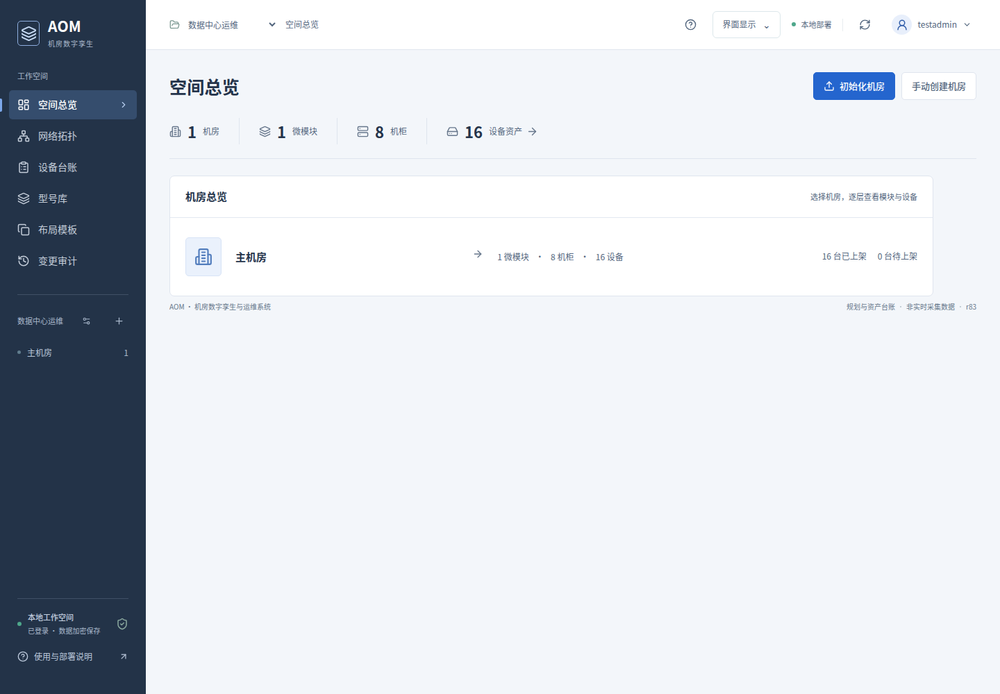
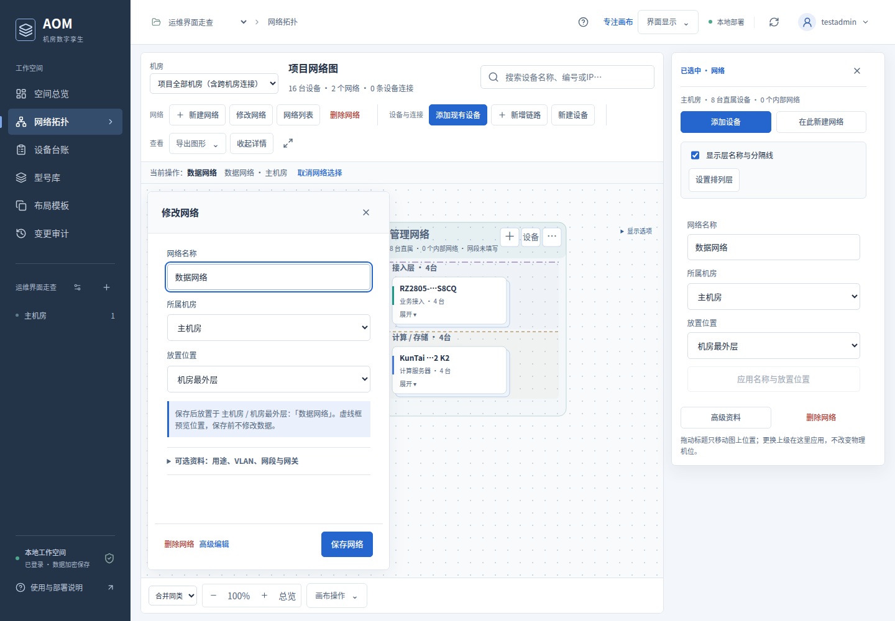

# AOM · 机房数字孪生与运维系统

应用处于开发阶段。采用 Go 单进程、内嵌 Vue/SVG 页面、内存 SQLite 和加密数据文件，通过浏览器在本机或可信局域网使用。

空间层级：**项目 → 机房 → 微模块 → 柜列 → 机柜与设施 → 柜内设备**。点位1、点位2位于同一主机房。

网络拓扑使用机房统一画布，网络矩形递归包含、选择不隐藏其他网络，内部排列层可按网络启用或隐藏并自定义。

交互原则：总览看概况，机房卡片单击进入；位置图单击选择、双击或“进入模块”继续查看，机位、状态、链路确认直接操作，修改详细信息进入编辑页。型号库支持CSV导入与自定义设备角色，右上角可查看常用快捷键。机房页面提供可拖动的立体示意位置图，微模块内的机柜与列间独立设施支持拖动排列。

## 界面预览

以下桌面界面截图使用临时验收数据。

**空间总览**：查看项目规模与机房列表，点击机房进入布局。



**网络拓扑与快捷设置**：在同一画布管理网络，打开设置时保持当前视野。



## 首次录入

点击 **初始化机房**，依次选择目标、上传设备总清单、检查并创建。系统按模块分组，复用已有布局或使用模板新建，自动排位并录入网络与连接。资料不足的部分留待人工确认。

- [使用说明：启动、导入、机房管理与备份](docs/使用说明.md)
- [网络拓扑：分组、分层、连接与删除](docs/网络拓扑使用说明.md)

设备清单使用 CSV UTF-8，可通过 Excel/WPS 填写后另存。示例位于 [examples](examples)。

## 本地启动

准备 Go、Node.js 和 npm，在项目目录执行：

```bash
npm ci
go mod tidy
npm run build
go run ./cmd/aom --data-dir ./data --addr 127.0.0.1:8080
```

浏览器打开 `http://localhost:8080`。首次使用复制后台控制台的初始化令牌，创建管理员账号与密码；之后登录进入工作空间。页面开发时可另开终端运行 `npm run dev`，接口代理至8080端口。

使用本地构建的运行目录时，本机启动 `start-local`，局域网启动 `start-lan`。目标电脑无需安装开发环境，数据加密保存到程序旁的 `data/app.vault`。局域网启动脚本使用HTTPS，客户端需核对并信任证书。

## 设计文档

- [界面与交互设计说明](docs/界面与交互设计说明.md)
- [系统设计](docs/系统设计.md)
- [接口说明](docs/接口说明.md)
